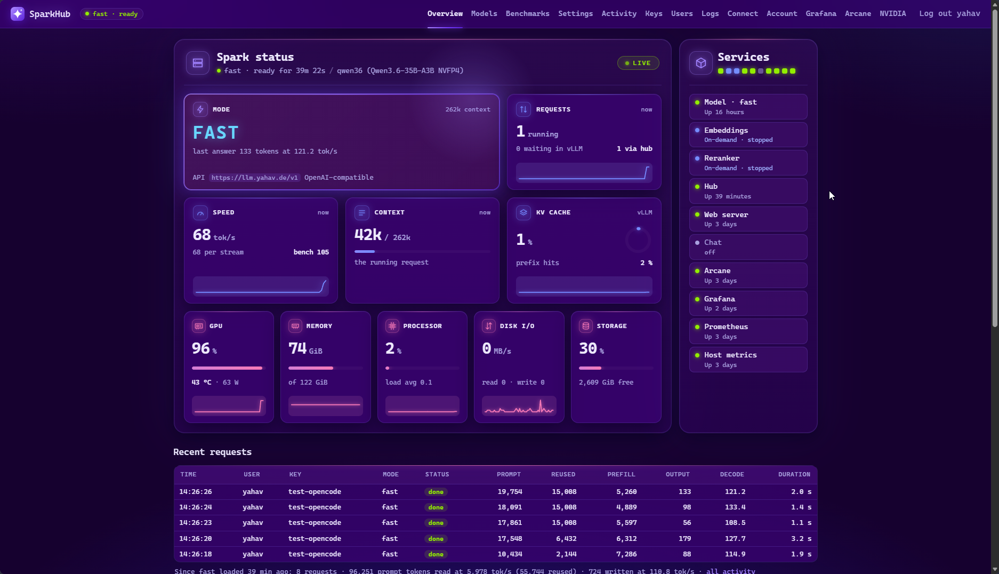
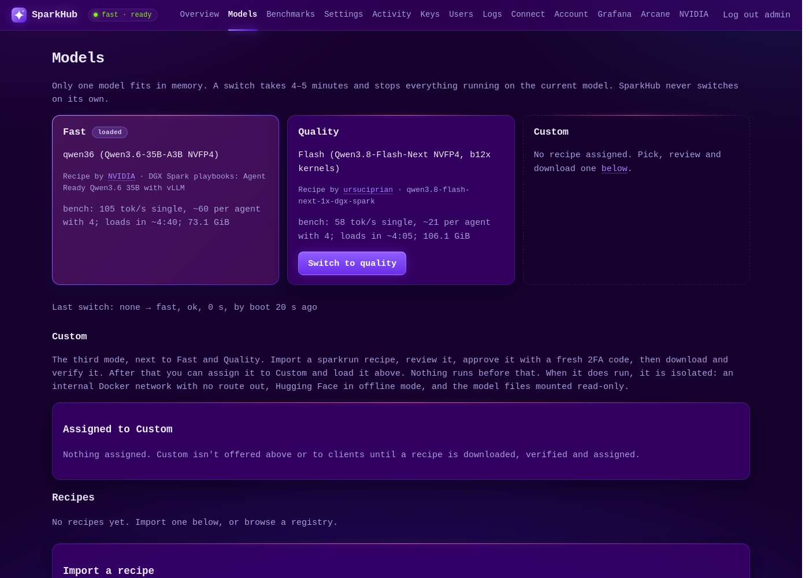
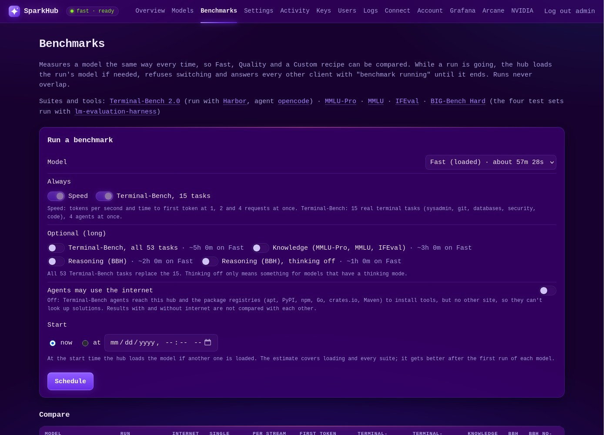

# SparkHub

**A private model server for one NVIDIA DGX Spark: an OpenAI-compatible API, a dashboard, and the tools to run
coding agents against it.**



The Spark has room for one large model at a time. SparkHub serves it to your machines and agents, lets you switch
between a fast model and a stronger one from the dashboard, and keeps everything on your own hardware.

- **Two tuned modes, one click apart.** Fast and Quality are benchmarked vLLM setups pinned to exact image digests
  and model revisions. A switch takes 4–5 minutes and never happens on its own: it is refused while other clients
  are using the model, unless you ask it to wait for them or cut them off.
- **A third mode from a recipe.** Import a [sparkrun](https://github.com/spark-arena/sparkrun) recipe, review the exact
  container, approve it with your authenticator app, and SparkHub downloads, verifies and runs it isolated: no
  network, read-only weights.
- **OpenAI-compatible gateway** at `/v1`: per-user API keys with roles and concurrency limits, usage history,
  optional embeddings and reranking. The hub never logs prompts or answers.
- **Built for agents.** A small CLI and an OpenCode skill switch modes and wait for the model, so a harness can pick
  the right model for a task.
- **Benchmarks** compare any mode the same way every time: speed, Terminal-Bench 2.0, knowledge and reasoning tests.
- **Operations included.** Grafana dashboards with alerts to your phone (ntfy), Docker UI (Arcane), web chat
  (chat-ui), nightly backups, a watchdog that reloads a crashed model.
- **Secure by default.** Password plus authenticator-app sign-in, TLS everywhere, and nothing listening beyond
  what you choose: the LAN, your tailnet, or your own domain.

| Mode | Model | Speed on the Spark | Disk |
|---|---|---|---|
| Fast | Qwen3.6-35B-A3B NVFP4 ([NVIDIA's playbook](https://github.com/NVIDIA/dgx-spark-playbooks/tree/main/nvidia/vllm#run-agent-ready-qwen36-35b-model-with-vllm)) | ~105–125 tok/s single stream, ~60–70 per agent with 4 | 22 GiB |
| Quality | Qwen3.8-Flash-Next NVFP4 on b12x kernels ([ursuciprian's recipe](https://github.com/ursuciprian/qwen3.8-flash-next-1x-dgx-spark)) | ~58 tok/s single stream, ~21 per agent with 4 | ~101 GiB |
| Custom | any vLLM recipe for one Spark that you approve | | |

<table><tr>
<td width="50%"></td>
<td width="50%"></td>
</tr></table>

## Install

You need a DGX Spark on DGX OS (Docker, the NVIDIA runtime, Compose and buildx come with it), your user in the
`docker` group, about 250 GB of free disk, and a Hugging Face account to accept the Quality model's license.

```bash
git clone https://github.com/Yahav/sparkhub.git ~/sparkhub && cd ~/sparkhub
./install.sh
```

The installer asks its questions up front (access mode, host name, optional pieces), shows anything you need to do
yourself (router, DNS, Tailscale), then sets everything up and runs a self-test. It asks before every `sudo`
command. Re-running it changes nothing on a finished install and repairs anything missing; `./install.sh --check`
reports without changing anything. The full guide, with every question and setting:
**[docs/INSTALL.md](docs/INSTALL.md)**.

## Upgrade

The hub checks once a day for a new release and tells admins on the dashboard and through ntfy. Then, on the Spark:

```bash
./install.sh upgrade
```

It shows the release notes, backs up the database, downloads new images and weights while the current model keeps
serving, and restarts only what changed. Everything SparkHub runs is pinned in this repository, so a release that
bumps a model or a component (Grafana, Arcane, vLLM) changes exactly those pins, and a model the release changed
reloads during the upgrade. Details: [docs/INSTALL.md#upgrading](docs/INSTALL.md#upgrading); what each release
changes: [CHANGELOG.md](CHANGELOG.md).

## Documentation

- [docs/INSTALL.md](docs/INSTALL.md): requirements, access modes, every installer question, day-to-day commands,
  upgrading, troubleshooting.
- [docs/ARCHITECTURE.md](docs/ARCHITECTURE.md): repository layout, how the pieces fit, Custom recipes, benchmarks,
  access and certificates, the API, the admin CLI, tests.
- [docs/benchmark-summary.md](docs/benchmark-summary.md): the benchmark behind the choice of models and settings.

## Built on

[vLLM](https://github.com/vllm-project/vllm) ·
[FastAPI](https://github.com/fastapi/fastapi) and [htmx](https://github.com/bigskysoftware/htmx) ·
[Prometheus](https://github.com/prometheus/prometheus) and [Grafana](https://github.com/grafana/grafana) ·
[nginx](https://nginx.org) · [Arcane](https://github.com/getarcaneapp/arcane) ·
[chat-ui](https://github.com/huggingface/chat-ui) · [llama.cpp](https://github.com/ggml-org/llama.cpp) (embeddings) ·
[Harbor](https://github.com/harbor-framework/harbor), [Terminal-Bench 2.0](https://github.com/laude-institute/terminal-bench-2)
and [lm-evaluation-harness](https://github.com/EleutherAI/lm-evaluation-harness) (benchmarks).
Model recipes by NVIDIA and ursuciprian, linked above.

## License

SparkHub is licensed under the [Apache License 2.0](LICENSE). The models have their own licenses: Fast's is
Apache-2.0, Quality's is the Qwen Community License 1.0, which the installer asks you to accept before downloading.

SparkHub is an independent project, not affiliated with or endorsed by NVIDIA.
